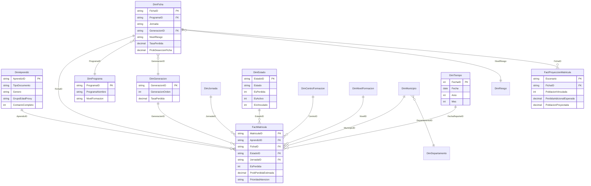

# Modelo estrella y reglas de construcción

## 1. Objetivo del modelo

El modelo resuelve cuatro preguntas sin mezclar granos:

1. **Matrícula**: ¿cuántos aprendices hay en cada ficha, programa, jornada y estado?
2. **Pérdida**: ¿cuántas matrículas se cancelaron o se retiraron, y con qué incertidumbre?
3. **Riesgo**: ¿qué fichas priorizar, con una probabilidad estructural y un intervalo creíble?
4. **Proyección**: ¿cuánta población vinculada se espera conservar bajo tres escenarios de permanencia?

El grano de `FactMatricula` es **una matrícula de aprendiz en una ficha**. Un aprendiz puede aportar dos filas si está en dos fichas; esto es intencional para gestionar fichas, no para contar personas.

---

## 2. Diagrama



---

## 3. Tablas y granularidad

| Tabla | Tipo | Grano | Filas |
|---|---|---|---:|
| `FactMatricula` | Hecho | Matrícula de aprendiz en ficha | 1.592 |
| `FactProyeccionMatricula` | Hecho | Ficha × escenario | 168 |
| `DimAprendiz` | Dimensión | Persona (documento hasheado) | 1.583 |
| `DimFicha` | Dimensión | Ficha | 56 |
| `DimPrograma` | Dimensión | Programa normalizado | 15 |
| `DimJornada` | Dimensión | Jornada | 3 |
| `DimEstado` | Dimensión | Estado del aprendiz | 7 |
| `DimTiempo` | Dimensión | Día | 1.095 |
| `DimCentroFormacion` | Dimensión | Centro | 1 |
| `DimNivelFormacion` | Dimensión | Nivel | 3 |
| `DimMunicipio` | Dimensión | Municipio | 1 |
| `DimDepartamento` | Dimensión | Departamento | 1 |
| `DimGeneracion` | Dimensión | Prefijo de ficha | 17 |
| `DimRiesgo` | Dimensión | Banda de riesgo | 4 |

---

## 4. Relaciones

| Desde (muchos) | Hacia (uno) | Activa | Nota |
|---|---|---:|---|
| `FactMatricula[AprendizID]` | `DimAprendiz[AprendizID]` | Sí | Persona |
| `FactMatricula[FichaID]` | `DimFicha[FichaID]` | Sí | Ficha |
| `DimFicha[ProgramaID]` | `DimPrograma[ProgramaID]` | Sí | Ruta única a programa |
| `DimFicha[GeneracionID]` | `DimGeneracion[GeneracionID]` | Sí | Generación de la ficha |
| `DimFicha[NivelRiesgo]` | `DimRiesgo[NivelRiesgo]` | Sí | Banda de riesgo |
| `FactMatricula[JornadaID]` | `DimJornada[JornadaID]` | Sí | Jornada |
| `FactMatricula[EstadoID]` | `DimEstado[EstadoID]` | Sí | Estado |
| `FactMatricula[CentroID]` | `DimCentroFormacion[CentroID]` | Sí | Centro |
| `FactMatricula[NivelID]` | `DimNivelFormacion[NivelID]` | Sí | Nivel |
| `FactMatricula[MunicipioID]` | `DimMunicipio[MunicipioID]` | Sí | Municipio (No informado) |
| `DimMunicipio[DepartamentoID]` | `DimDepartamento[DepartamentoID]` | Sí | Departamento (No informado) |
| `FactMatricula[GeneracionID]` | `DimGeneracion[GeneracionID]` | Sí | Generación de la matrícula |
| `FactMatricula[FechaReporteID]` | `DimTiempo[FechaID]` | Sí | Fecha de snapshot |
| `FactProyeccionMatricula[FichaID]` | `DimFicha[FichaID]` | Sí | Proyección por ficha |

**Decisiones para evitar ambigüedad**

- `FactMatricula` conserva `ProgramaID` como columna técnica, pero **no** se relaciona directamente con `DimPrograma`; la ruta es `Fact → DimFicha → DimPrograma`. Así se evita un segundo camino activo y el filtro de programa siempre pasa por la ficha.
- `FactMatricula` conserva `GeneracionID` y se relaciona con `DimGeneracion`; `DimFicha` también tiene `GeneracionID`, pero no se relaciona para no duplicar la ruta.
- `DimFicha[Jornada]` es texto descriptivo; la relación de jornada se hace por `FactMatricula[JornadaID]`.
- `FactMatricula[DepartamentoID]` queda como columna técnica; la ruta es `Fact → DimMunicipio → DimDepartamento`.
- `FactProyeccionMatricula` se relaciona solo por `FichaID`; programa y generación se leen a través de `DimFicha`.

---

## 5. Reglas ETL

### 5.1 Lectura

- 56 archivos `.xls` leídos con `xlrd`.
- La tabla comienza en la fila 5; la fila 1 contiene ficha, jornada, programa, estado y fecha.
- Se validan 7 columnas y se normalizan encabezados (tildes, espacios, mayúsculas).
- Los archivos se abren en modo lectura; no se escriben.

### 5.2 Identidad

- `AprendizID = "APR-" + SHA256(documento)[:10].upper()`.
- El documento original no se guarda en `data/processed/`.
- Si el mismo documento aparece en varias fichas, se conserva una fila por ficha y se marca `TieneMultiplesFichas=1`.

### 5.3 Estados

- `CANCELADO` y `RETIRO VOLUNTARIO` → `EsPerdida=1`.
- `TRASLADADO` → `EsPerdida=0`, `EsVinculado=0`, `EsActivo=0`.
- `APLAZADO` → `EsVinculado=1`, `EsActivo=0`.
- `CONDICIONADO` → `EsActivo=1`, `EsRiesgo=1`.
- `CERTIFICADO` no aparece; `EsCertificado=0` en todos los registros.

### 5.4 Fechas

- Todas las fichas reportan `2026-10-19`.
- `FechaReporteID = 20261019`.
- `DimTiempo` cubre 2024-01-01 a 2026-12-31 para futuras series; no se inventan hechos históricos.

### 5.5 Programa y nivel

- 15 nombres canónicos; los originales se conservan en `data/restricted/aprendices_crudos.json`.
- El nivel se infiere con reglas de nombre (`Técnico` si contiene “TÉCNICO” o “AUXILIAR”; en los demás casos `Tecnólogo`).
- `NivelFuente = "Inferido del nombre; validar SOFIA Plus"`.

### 5.6 Generación

- `GeneracionID = "GEN-" + primeros 3 dígitos de la ficha`.
- `GeneracionOrden` asigna 1 a 314, 2 a 317, etc. No es un año.
- `DimGeneracion.TasaPerdida` se calcula sobre las matrículas de la generación.

### 5.7 Contacto

- `CelularValido = 1` si tiene exactamente 10 dígitos.
- `EmailValido = 1` si cumple estructura básica y dominio con punto.
- `ContactoCompleto = CelularValido AND EmailValido`.
- `EmailDominio` conserva solo el dominio; no el usuario.
- **El contacto incompleto no entra al índice de riesgo.** Se usa como bandera de contactabilidad.

---

## 6. Índice de riesgo por ficha

El índice no es un score multifactorial. Es un **percentil de la tasa de pérdida ajustada por empirical Bayes**:

\[
\hat{p}_f = \frac{y_f + k \cdot \bar{p}}{n_f + k}, \quad k=10
\]

donde \(y_f\) son las pérdidas de la ficha, \(n_f\) sus matrículas y \(\bar{p}=0.2758\) la tasa global. Luego:

\[
Percentil_f = \text{rank percentil de } \hat{p}_f \text{ entre las 56 fichas}
\]

Bandas:

| Nivel | Percentil | Fichas | Matrículas | Pérdidas | Tasa observada |
|---|---:|---:|---:|---:|---:|
| Bajo | < 50 | 28 | 789 | 87 | 11,03% |
| Medio | 50–75 | 14 | 389 | 137 | 35,22% |
| Alto | 75–90 | 8 | 208 | 99 | 47,60% |
| Crítico | ≥ 90 | 6 | 206 | 116 | 56,31% |

La validación es monotónica: a mayor banda, mayor tasa observada. No es una validación predictiva temporal; es una comprobación de coherencia interna.

**Por qué no se incluyó contacto incompleto:** su asociación cruda con pérdida es nula (OR 1,17; p=0,368) y la ajustada por programa invierte el signo (OR MH 0,65). Está confundido con cohortes nuevas que aún no acumulan pérdidas. Incluirlo produciría un ranking engañoso.

---

## 7. Probabilidad predictiva por ficha

El modelo beta-binomial usa la misma lógica bayesiana, pero reporta la **media posterior** y un **intervalo creíble del 95%**:

\[
p_f \mid y_f \sim \text{Beta}(y_f + \alpha_0,\; n_f - y_f + \beta_0)
\]

con \(\alpha_0 = 2.758\), \(\beta_0 = 7.242\) (prior de media 27,58% y fuerza k=10). La media posterior es la probabilidad reportada; los percentiles 2,5% y 97,5% forman el intervalo.

Esto no es un pronóstico individual: es una **tasa estructural suavizada** que permite comparar fichas pequeñas sin que el azar las lleve a 0% o 100%.

---

## 8. Proyección de permanencia

`FactProyeccionMatricula` no es un modelo temporal. Es un ejercicio de escenarios:

1. Se estima un **plateau** con las cohortes maduras (prefijos 314–340): 43,19% de pérdida acumulada.
2. Se suaviza por programa con \(k=50\): \(\text{plateau}_p = (y_p + 50\cdot\text{plateau}_{global})/(n_p+50)\).
3. Para cada ficha, la pérdida adicional esperada es:
   \[
   \text{pérdida adicional} = \max\left(0, \frac{\text{plateau}_p - p_{obs}}{1-p_{obs}}\right)\times \text{vinculados}
   \]
4. Escenarios: Optimista = plateau − 7 pp; Base = plateau por programa; Pesimista = plateau + 7 pp.

Resultado base: 1.144 vinculados → 856 proyectados (−288; 45,6% de pérdida proyectada). **No proyecta nueva matrícula** porque no hay serie temporal ni fecha de matrícula.

---

## 9. Archivos y dependencias

```
data/processed/
  DimAprendiz.csv
  DimFicha.csv
  DimPrograma.csv
  DimJornada.csv
  DimEstado.csv
  DimTiempo.csv
  DimCentroFormacion.csv
  DimNivelFormacion.csv
  DimMunicipio.csv
  DimDepartamento.csv
  DimGeneracion.csv
  DimRiesgo.csv
  FactMatricula.csv
  FactProyeccionMatricula.csv
```

`02_etl_modelo_estrella.py` crea las dimensiones y el hecho; `04_modelo_predictivo.py` agrega las columnas de probabilidad, alerta y prioridad. El dashboard HTML, el Excel y el PBIP consumen estos mismos CSV para garantizar consistencia.

---

## 10. Validaciones automáticas

- 1.592 filas en `FactMatricula`; 1.583 en `DimAprendiz`; 56 en `DimFicha`.
- Suma de conteos por estado = 1.592.
- `Pérdidas = 439`; `Activos = 1.137`; `Vinculados = 1.144`.
- Cada `FichaID` del hecho existe en `DimFicha`.
- Cada `AprendizID` del hecho existe en `DimAprendiz`.
- `NivelRiesgo` de las 56 fichas coincide con la banda de `DimRiesgo`.
- `FactProyeccionMatricula` tiene 168 filas (56 × 3) y suma de vinculados = 1.144 por escenario.
- No hay nombres, documentos, celulares ni correos en `data/processed/`.

Estas validaciones se ejecutan al final de los scripts 02 y 04; cualquier fallo detiene la generación.
